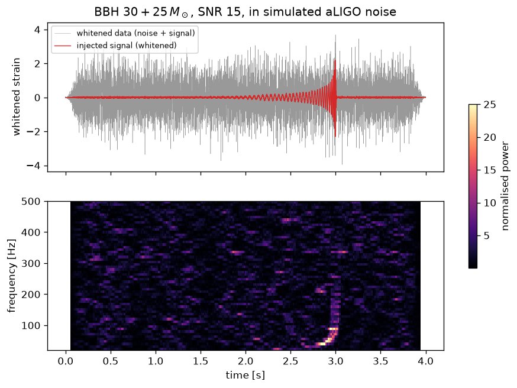
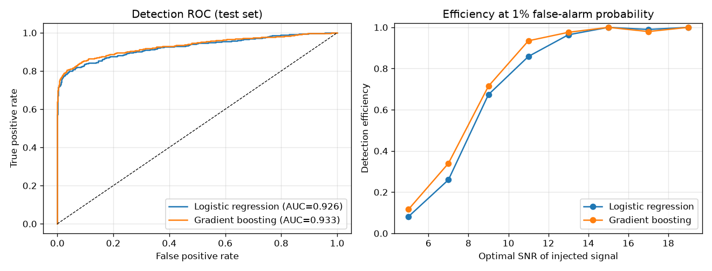
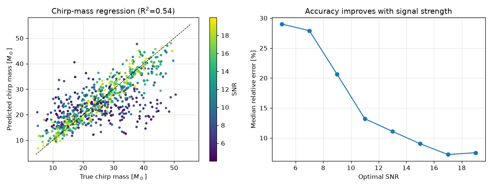
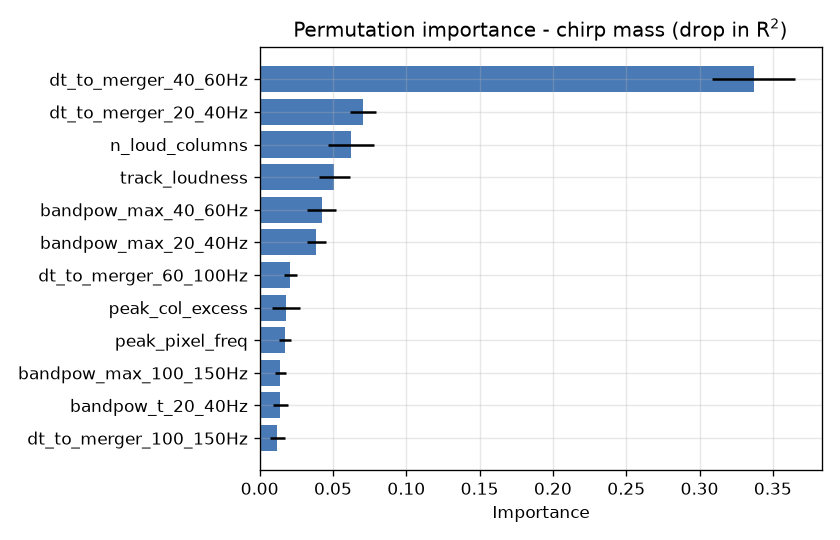

# Detecting binary black hole mergers with scikit-learn

Can classical machine learning find gravitational-wave signals buried in detector
noise, and estimate the source's chirp mass from them?

This project simulates LIGO-like data, reduces every segment to a set of
**physically interpretable tabular features**, and trains scikit-learn models for

1. **Detection** – does a 4 s segment contain a binary black hole (BBH) merger?
2. **Parameter estimation** – what is the chirp mass $\mathcal{M}_c$ of the binary?



## Data

| | |
|---|---|
| Noise | Gaussian, coloured by the Advanced LIGO design PSD (`aLIGOZeroDetHighPower`) |
| Signals | `IMRPhenomD` inspiral–merger–ringdown waveforms (PyCBC) |
| Masses | $m_1, m_2 \sim U(5, 60)\,M_\odot$ |
| Optimal SNR | $\sim U(4, 20)$ |
| Segment | 4 s at 2048 Hz, merger at 2.5–3.5 s, random polarisation mix |
| Size | 6000 segments, 50 % with a signal |

Each segment is whitened using the known PSD, then turned into ~30 features from
its spectrogram (see [`src/features.py`](src/features.py)):

* excess power in 7 frequency bands, and **when** each band peaks
* the loudest time–frequency pixel (power, frequency, time)
* a fitted *chirp track* – how fast the dominant frequency rises before merger
* `dt_to_merger_*` – how long before the merger each band lights up.
  From the leading-order post-Newtonian result
  $\tau(f) \propto \mathcal{M}_c^{-5/3} f^{-8/3}$, heavier binaries sweep through
  a band faster, so these features carry the chirp mass.

## Results

### Detection

| Model | 5-fold CV AUC | Test AUC |
|---|---|---|
| Logistic regression | 0.926 ± 0.005 | 0.926 |
| Gradient boosting (`HistGradientBoostingClassifier`) | 0.926 ± 0.003 | 0.933 |



At a 1 % false-alarm probability the gradient-boosting model detects
~68 % of signals at SNR 8–10 and >90 % above SNR 10. The overall AUC is limited by
the deliberately included very weak signals (SNR 4–6), which are essentially
undetectable for any method.

### Chirp mass

`HistGradientBoostingRegressor` on $\log \mathcal{M}_c$ (signal segments only):

| Metric | Value |
|---|---|
| Test MAE | 4.8 $M_\odot$ (baseline "always predict the median": 8.7 $M_\odot$) |
| Test $R^2$ | 0.55 |
| Median relative error, all SNRs | 13 % |
| Median relative error, SNR > 12 | 9 % |



### What did the model learn?

Permutation importance shows the regressor relies overwhelmingly on
`dt_to_merger_40_60Hz` – the time between the signal crossing 40–60 Hz and the
merger. That is exactly the frequency-evolution relation above: the model
rediscovered the physics that determines the chirp mass.



## Limitations

* **Matched filtering is the optimal detector** for known waveforms in Gaussian
  noise; this project is a study of what feature-based ML can do, not a
  replacement for LIGO pipelines.
* The noise is stationary and Gaussian. Real data contain glitches (non-Gaussian
  transients), which are where ML methods are most useful in practice.
* Single detector, non-spinning-aligned BBH only; SNR is drawn directly rather
  than from a physical distance distribution.

## Reproduce

```bash
pip install -r requirements.txt
python src/simulate.py --n 6000 --out data/dataset.csv   # ~1 min on 2 cores
python src/train.py --data data/dataset.csv               # figures/ and results/metrics.json
python src/plot_example.py                                # figures/example.png
```

## Possible extensions

* Inject real glitches or use real noise from [GWOSC](https://gwosc.org) and test robustness
* Add a template-bank matched-filter SNR as a feature / baseline
* Predict mass ratio and merger time as well
* Compare with a 1-D CNN on the whitened strain (PyTorch)

## Repository structure

```
src/simulate.py      data generation (PyCBC waveforms + coloured noise)
src/features.py      whitening and feature extraction
src/train.py         models, cross-validation, evaluation, importance plots
src/plot_example.py  example figure
figures/             generated plots
results/metrics.json generated metrics
```
